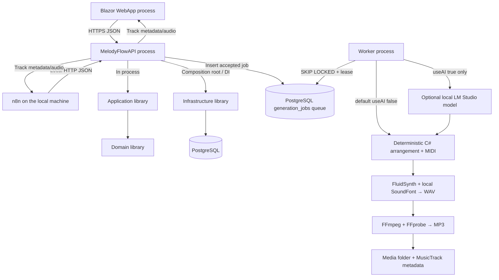

# Architecture — API host, Clean-inspired layers, durable worker

## Deployment view

**Current decision:** `MelodyFlowAPI` is the public REST boundary and the ASP.NET Core host. It composes `Application` and `Infrastructure` through dependency injection in the same process. There is no `Backend.Host` project and none should be created for this topology. The Web App and local n8n call the API over HTTP; Domain, Application and Infrastructure remain class libraries. `Contracts` contains DTOs and does not provide the transport. The local app has no user login; development launch profiles bind to localhost and CORS only allows configured Web App origins. n8n is a server-to-server caller, so browser CORS does not authorize it.

## Clean dependency direction

- Domain does not reference Application, API, Infrastructure, EF Core or n8n.
- Application depends on Domain; defines use-case interfaces/ports.
- Infrastructure depends on Application/Domain and implements repositories/storage/provider integrations.
- API is the public HTTP composition root and wires Application+Infrastructure through DI; it does not call a second backend over HTTP. Worker is its own composition root for queue execution and wires the same libraries in its process.
- Web App and API use versioned Contracts at the public HTTP boundary; do not share EF entities through HTTP.
- Worker runs as a separate process and connects to the same MelodyFlow PostgreSQL database. The `generation_jobs` table is the durable queue; there is no extra broker service.

## Failure boundaries

The API health endpoint returns a sanitized 503 when PostgreSQL is unreachable. `POST /api/v1/generation-jobs` returns 202 only after the job row is committed. Worker claims use `FOR UPDATE SKIP LOCKED`, a unique lease token and periodic renewal; an expired lease becomes a retry or a terminal failure after three total attempts. The job row itself is both accepted work and queue record, so an API-to-broker outbox is not needed for this topology. PostgreSQL is a shared dependency; independent processes alone are **not** high availability.

## Ownership

- API handles local CORS, rate limiting, request validation, HTTP mapping and host composition. User authentication is intentionally absent for this local-only phase.
- Application implements project and generation-job use cases, including idempotency scoped to project + job type.
- Domain enforces valid states, lengths, music planning limits.
- Infrastructure owns Npgsql EF Core DbContext/config/migrations and provider adapters.
- Worker owns queue polling, leases, progress, retries and registered job handlers. Its Music handler needs audio tools and a SoundFont; LM Studio/model configuration is required only for jobs with `useAI: true`.
- n8n triggers workflow and calls stable local API endpoints; it does **not** reach into PostgreSQL directly.

## Current phase boundary

The API project owns the public host. Do not add another host or duplicate application logic. The PostgreSQL queue, local music handler, track metadata and MP3 download endpoints are implemented. Manual visual import, video rendering and publishing remain later phases. Keep the existing WebApp, API, Application, Domain, Infrastructure, Contracts, Worker and Tests projects.
