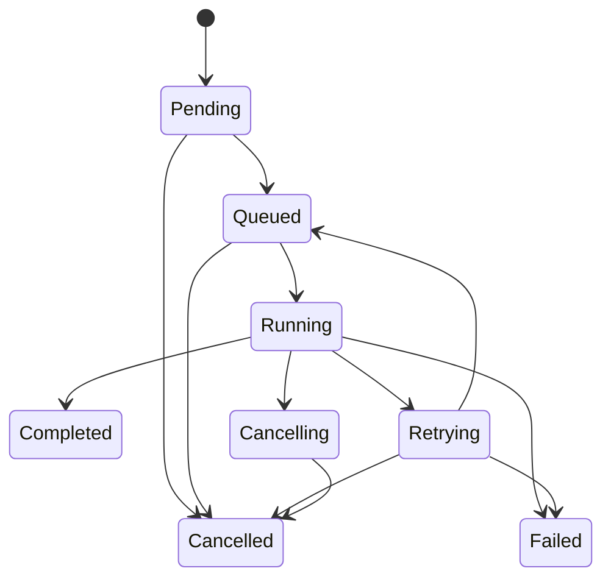

# Job lifecycle & automations

## State machine

State changes must enforce transition rules and concurrency. Do not declare Completed until output exists and is validated. Cancel request is cooperative for long-running provider tasks. API queueing and cancellation are available; Worker claims use PostgreSQL row locks and renewable leases.

`Retrying` is persisted while a transient failure waits for another attempt; cancellation during this wait moves directly to `Cancelled`. `Cancelling` is persisted while the worker stops safely before moving a running job to `Cancelled`. `MaxAttempts=3` includes the original attempt. Retry delay is exponential from five seconds and capped at five minutes. Idempotency keys are scoped to project + job type; a key replay with changed parameters returns 409.

## Worker lifecycle
1. Claim a due `Queued` or `Retrying` row in a short transaction with `FOR UPDATE SKIP LOCKED`.
2. Set `Running`, increment `AttemptCount`, and assign a random lease token and expiry.
3. Renew the lease during execution; if API cancellation changes the job to `Cancelling`, stop cooperatively and commit `Cancelled`.
4. If a process dies, reclaim an expired lease; schedule another attempt or mark `Failed` after the third total attempt.
5. The Worker registers its Music handler when the SoundFont/license reference and local audio executables are configured. LM Studio and a model are needed only for jobs that explicitly set `useAI: true`.
6. The handler validates safe parameters, requests the local arrangement plan, creates MIDI/MP3 with timeout and cancellation, and reports progress.
7. Persist result metadata and job progress; media bytes remain in storage, not PostgreSQL.
8. Keep structured logs but redact prompts where sensitive and never log keys.

The queue lifecycle and Music handler are implemented. The Worker claims only job types with a registered handler; when local generation prerequisites are missing, it does not register the Music handler and accepted jobs stay available in PostgreSQL.

## Music-to-video pipeline
`Configure -> Create project -> Queue music job -> Generate audio assets -> Review -> Queue visual job -> Review -> Queue render -> FFmpeg mix + encode -> Review rights/quality -> Queue YouTube upload -> YouTube ID -> Analytics snapshots`.

## n8n division of labor
- Local n8n may schedule campaigns and call the generation-job endpoint with an idempotency key.
- The API/Application own accepted job state; Worker owns execution. API returns 202 only after the PostgreSQL insert commits.
- The local-only API has no user/service authentication; keep n8n and API local. Do not expose webhooks or the API remotely.
- Do not keep a long-running HTTP connection open waiting for media generation.

## Resilience & costs
Track provider billable generation attempts; cap per project/day; cancel stale work; use dead-letter queue. Upload public only after review and supported rights confirmation. Record why an asset was accepted or rejected.
